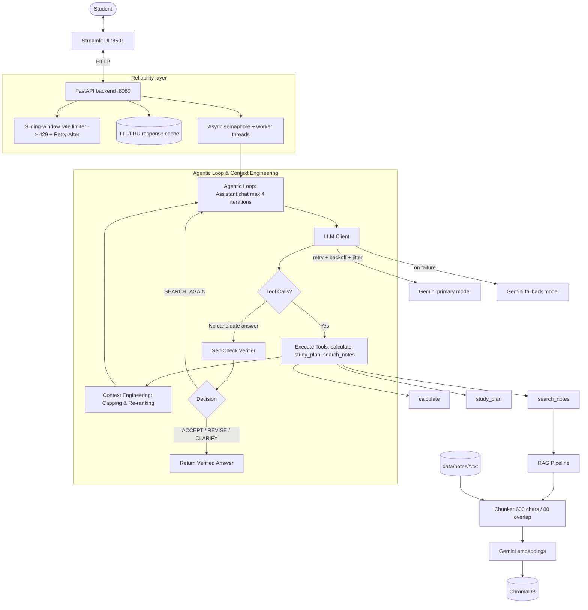

# StudyHelper — W15 + W16 (Applied AI + Agentified Assistant)

A study assistant that answers questions from your own course notes (RAG), does arithmetic and builds
revision schedules through tool calling, and returns validated JSON "study cards". Backend is FastAPI,
UI is Streamlit, LLM is Google Gemini (via its OpenAI-compatible endpoint), vector DB is ChromaDB.

## Architecture (Week 16 Agentic System)



## Week 16: Agentify the Assistant

### 1. Feature Justification
A fixed pipeline cannot evaluate whether an initial answer accurately and completely satisfies the query against dynamic tool outputs or retrieved notes, whereas an agentic loop enables autonomous self-checking, re-searching, and query refinement before responding.

### 2. Context Engineering Technique
We implemented **Capping and Re-ranking of Retrieval Results** in `RAGPipeline.retrieve` / `rerank_and_cap_hits` (in `src/studyhelper/rag/pipeline.py`) and tool output handling (in `src/studyhelper/assistant.py`). Retrieval hits are re-ranked based on query-term overlap and vector similarity, capped at top 3 results, and truncated to a maximum of 350 characters per chunk; this directly solves prompt context window saturation and unnecessary token bloat during multi-iteration agent loops.

### 3. Agentic Pattern
We selected a **Single-Agent Loop with Self-Check Verification** pattern. Based on class frameworks, a single-agent loop avoids the context saturation and sequential communication bottleneck of multi-agent handoffs for standard tutoring workflows while eliminating the risk of multi-agent cascading failures.

### 4. Skill vs. Agent
While deterministic text processing or formula calculation could be implemented as a stateless Skill, autonomous self-verification and dynamically deciding whether to search again or ask for clarification requires maintaining trajectory state and making model-driven decisions across iterations, making an Agent necessary.

### 5. Tool vs. Agent Boundary
External stateful services (such as ChromaDB vector storage, mathematical evaluation, and calendar planning) are modeled as bounded, stateless tool calls (`calculate`, `study_plan`, `search_notes`) wrapped in rigid argument validation schemas rather than separate agents. Modeling stateful service calls as tools enforces strict contract boundaries, predictable error handling, and low latency while reserving reasoning and decision-making exclusively for the core agentic loop.

### 6. Failure Injection Test
We introduced failure injection testing via `INJECT_FAILURE_FLAG` in `src/studyhelper/tools.py` (simulating downstream tool timeout/service unavailability) and division-by-zero expression failures. When tool execution fails, the agentic loop gracefully captures the tool error message, passes it to the self-check verifier, and safely presents a helpful error explanation or clarification request to the user without hallucinating false answers.

### 7. Standalone Evaluation Harness
Our custom harness (`eval_harness.py`) evaluates a test batch without external dependencies and logs summary metrics to `eval_results.md`:
- **Task Completion Rate**: Tracks successful outputs vs. loop failures.
- **Tool-Call Correctness**: Validates selected tool and parameter schema.
- **Trajectory Length**: Measures iteration count per query.
- **Token & Cost Accounting**: Tracks prompt/completion tokens and Gemini API costs.
- **Failure Taxonomy**: Strictly classifies errors into `Hard failure`, `Soft failure`, or `Cascading soft failure`.

---

## What is implemented (Task 1 & Task 2)

| Requirement | Where |
|---|---|
| LLM integration (Gemini) | `src/studyhelper/llm_client.py` |
| Prompt engineering + `temperature` / `top_p` | `assistant.py` (system prompt), `config.py` (env-tunable, defaults 0.2 / 0.9) |
| Structured output (valid JSON) | `Assistant.study_card`: JSON mode + Pydantic `StudyCard` validation + one repair retry |
| Tool calling & Agentic loop | `tools.py` (`calculate`, `study_plan`, `search_notes`), self-check loop in `Assistant.chat` |
| Context Engineering | `RAGPipeline.rerank_and_cap_hits` in `src/studyhelper/rag/pipeline.py` |
| Custom Eval Harness | `eval_harness.py` -> `eval_results.md` |
| RAG: ingestion, chunking, embeddings, vector DB | `rag/` — word-boundary chunker, Gemini embeddings, ChromaDB |
| Containerization | `Dockerfile`, `docker-compose.yml` |

## Run it

```bash
uv sync
cp .env.example .env          # then put your GEMINI_API_KEY in .env
uv run pytest -q              # 13 tests, use a fake LLM, no key needed
uv run python eval_harness.py # runs custom evaluation harness and generates eval_results.md
uv run uvicorn studyhelper.app:app --port 8080
uv run streamlit run src/studyhelper/ui.py --server.port 8501
```

Docker: `docker compose up --build`, then open http://localhost:8501 and click **Index notes folder**.
Put your own `.txt` / `.md` notes in `data/notes/` (the two sample files there are placeholders).

API: `GET /health`, `POST /ingest`, `POST /ask`, `POST /chat`, `POST /study-card`.
