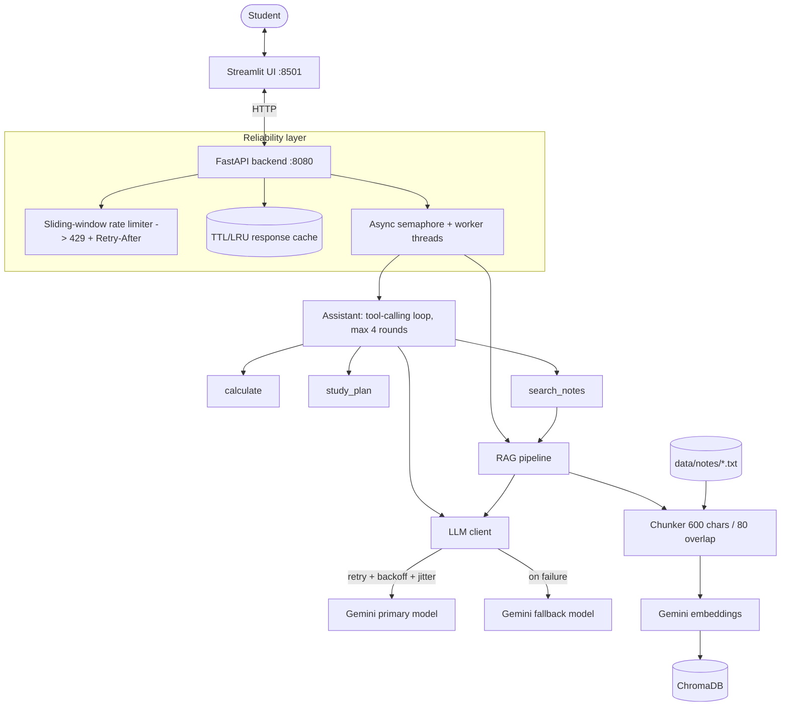

# StudyHelper — W15 (Applied AI + Productionized Assistant)

A study assistant that answers questions from your own course notes (RAG), does arithmetic and builds
revision schedules through tool calling, and returns validated JSON "study cards". Backend is FastAPI,
UI is Streamlit, LLM is Google Gemini (via its OpenAI-compatible endpoint), vector DB is ChromaDB.

## Architecture



## What is implemented (Task 1)

| Requirement | Where |
|---|---|
| LLM integration (Gemini) | `src/studyhelper/llm_client.py` |
| Prompt engineering + `temperature` / `top_p` | `assistant.py` (system prompt), `config.py` (env-tunable, defaults 0.2 / 0.9) |
| Structured output (valid JSON) | `Assistant.study_card`: JSON mode + Pydantic `StudyCard` validation + one repair retry |
| Tool calling | `tools.py` (`calculate`, `study_plan`, `search_notes`), loop in `Assistant.chat` |
| RAG: ingestion, chunking, embeddings, vector DB | `rag/` — word-boundary chunker, Gemini embeddings, ChromaDB |
| Containerization | `Dockerfile`, `docker-compose.yml` |
| Local open-source model via vLLM | **Not run — I have no GPU.** An optional `vllm` service is in the compose file under the `gpu` profile. |

## What is implemented (Task 2)

- **Web UI**: Streamlit with chat (shows tool calls), notes indexing, and study-card tabs.
- **Concurrency**: blocking LLM calls run in worker threads via `asyncio.to_thread`, bounded by an `asyncio.Semaphore` (default 5).
- **Caching**: SHA-256 keyed LRU cache with TTL on `/ask` and `/study-card`; cleared when notes are re-ingested.
- **Retry**: exponential backoff + jitter on connection errors, timeouts, 429 and 5xx.
- **Fallback**: if the primary model fails after retries, the call goes to the fallback model.
- **Rate limiting**: sliding window per client IP (default 30/min), returns `429` with `Retry-After`.
- **Graceful degradation**: both models down returns `503` with a plain message; invalid model JSON returns `502`; the UI shows readable errors.
- **ONNX**: not applicable. Generation and embeddings are both served by Gemini's API, so there is no local model to convert. If embeddings were moved on-device, ONNX would be the first optimisation to try.

## Run it

```bash
uv sync
cp .env.example .env          # then put your GEMINI_API_KEY in .env
uv run pytest -q              # 12 tests, use a fake LLM, no key needed
uv run uvicorn studyhelper.app:app --port 8080
uv run streamlit run src/studyhelper/ui.py --server.port 8501
```

Docker: `docker compose up --build`, then open http://localhost:8501 and click **Index notes folder**.
Put your own `.txt` / `.md` notes in `data/notes/` (the two sample files there are placeholders).

API: `GET /health`, `POST /ingest`, `POST /ask`, `POST /chat`, `POST /study-card`.

## Deployment notes

The compose stack runs anywhere Docker runs. For a cloud VM: install Docker, copy the repo and a `.env`,
run `docker compose up -d --build`, and open ports 8501 (UI) and 8080 (API). Keep the API key in the
environment, never in the image.
